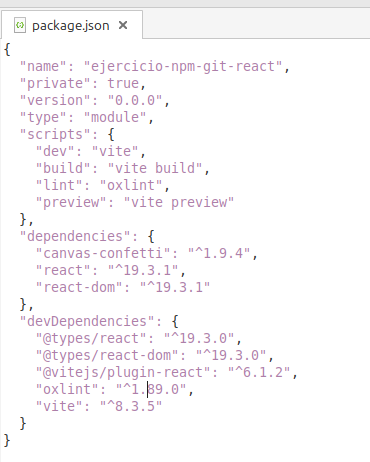
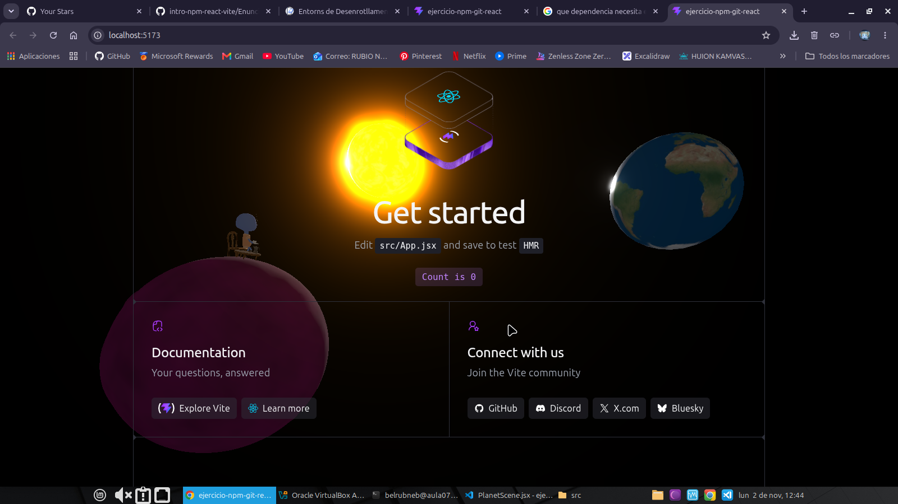

# Repositorio para la actividad de React

En este repositorio he llevado a cabo la actividad 'npm + react + git' de la asignatura Entornos de Desarrollo

- Captura del ejercicio 4:

- Capturas del ejercicio 5:

- Capturas del ejercicio 6:

## Ejercicio 9.
**Si la carpeta node_modules/ está excluida, ¿borrar una dependencia hace alguna acción sobre el repositorio? ¿Cuál?**

El efecto que tiene borrar una dependencia es que se borrar de package.json y por ende todo lo que tengas relacionado con esa dependencia dejará de funcionar. A menos que no la hayas usado, no se habrá guardado en ese archivo y provocará ningún cambio.